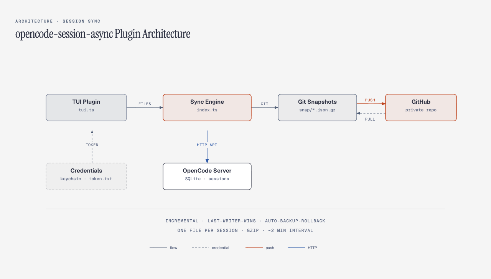

# opencode-session-async

[](LICENSE)
[](https://opencode.ai)

[English](./README.md) | [简体中文](./README.zh-CN.md)

Cross-device session sync and backup plugin for OpenCode.

Switch computers, lose a disk, accidentally delete — your conversation history never disappears.

## The Problem

OpenCode stores all session data in a local SQLite file with no cloud sync:

```
~/.local/share/opencode/opencode.db   ← gone on a new machine
```

| What happens | Why | How this plugin fixes it |
|---|---|---|
| New computer, no history | Data is local-only | Open opencode, all sessions appear automatically |
| Disk failure / OS reinstall, data lost | No backup | Full restore from your GitHub private repo |
| Work computer vs home computer, no shared context | No multi-device sync | Near real-time bidirectional sync (default: 2 min interval) |
| Accidentally deleted a session | Gone forever | Remote snapshots, restore anytime |

## Quick Start

### Install

```bash
opencode plugin add github:nbb-ai/opencode-session-async
```

### First Connection (30 seconds)

1. Open opencode
2. TUI shows a "Session Sync" dialog → click "Connect GitHub"
3. Enter the verification code in your browser
4. Done. The plugin creates a private repo and starts syncing.

No `gh` CLI needed. No SSH keys. No manual repo creation.

### New Computer

```bash
opencode plugin add github:nbb-ai/opencode-session-async
opencode    # open → authorize → all history sessions appear
```

~740 sessions imported in about 40 seconds.

## What Gets Synced

| Synced | Not synced |
|---|---|
| All top-level sessions (messages, tool calls, code) | API keys / `opencode.json` |
| Session title, timestamps, model info | Sub-agent sessions |
| Session deletions (bidirectional) | Sessions over 32MB (configurable) |

## Architecture



- **Incremental**: one gzip file per session, only changed files transfer
- **Conflict resolution**: last-writer-wins (highest `time.updated` wins)
- **Safe replace**: backup → delete → import → verify, auto-rollback on failure
- **Delete propagation**: deleting on machine A removes it on machine B

## Privacy & Security

- Data lives in **your own** GitHub account, no third-party servers
- Repository is forced **private** (non-private repos refuse to sync)
- All transfers via HTTPS encryption
- GitHub token stored in macOS Keychain (zero plaintext on disk); Linux uses `token.txt` (600 permissions)
- Authorization: GitHub OAuth device flow (one browser click)

## Configuration

`~/.config/opencode/session-sync.json`:

```jsonc
{
  "enabled": true,
  "repoName": "opencode-sessions",
  "authMode": "device",              // device (browser only) | auto (prefer gh) | gh
  "deviceFlowClientId": "Ov23...", // built-in default, override if needed
  "interval": 120,                   // sync interval (seconds)
  "maxSessionMB": 32,                // max session size (MB)
  "onConflict": "replace",           // replace | keep-local
  "gcDays": 90                       // snapshot retention (days)
}
```

## Commands

| Command | Action |
|---|---|
| `/session-sync` | Show sync status |
| `/session-sync now` | Sync immediately |
| `/session-sync setup` | Re-run GitHub connection wizard |
| `/session-sync gc 90` | Clean snapshots older than 90 days |
| `/session-sync doctor` | Diagnostics |

TUI palette (`Ctrl+P`) → "Session Sync" also available.

## Requirements

- OpenCode ≥ 2.0
- macOS (Keychain) or Linux (file-based credentials)
- GitHub account (that's it — OAuth App is built in, zero config)

## License

MIT

---