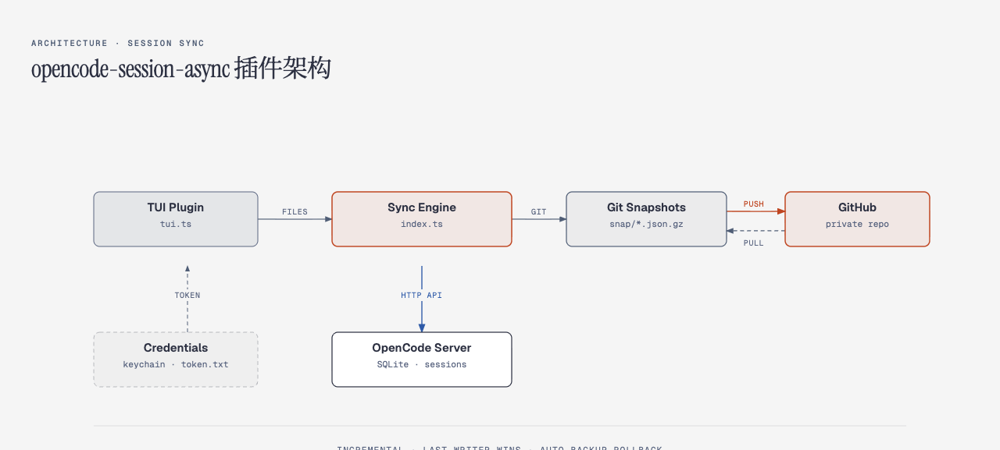

# opencode-session-async

[](LICENSE)
[](https://opencode.ai)

**[English](./README.md) | [简体中文](./README.zh-CN.md)**

OpenCode 会话跨设备同步 + 备份插件。

换电脑、磁盘坏、误删 —— 你的会话记录永远不丢。

## 解决什么问题

OpenCode 的会话数据只存在本机 SQLite 里，没有云端：

```
~/.local/share/opencode/opencode.db   ← 换台电脑就看不到了
```

| 你遇到的 | 原因 | 本插件怎么解决 |
|---|---|---|
| 换了台电脑，之前的会话全没了 | 数据只在本地 | 打开 opencode，历史会话自动出现 |
| 磁盘坏了 / 系统重装，对话记录丢了 | 没有备份 | 从 GitHub 私有仓库完整恢复 |
| 公司电脑聊的，家里电脑看不到 | 多设备不同步 | 双向近实时同步（默认 2 分钟轮询） |
| 误删了一个重要会话 | 删了就没了 | 远端有快照，随时导回 |

## 快速开始

### 安装

```bash
opencode plugin add github:nbb-ai/opencode-session-async
```

### 首次连接（30 秒）

1. 打开 opencode
2. TUI 弹出「会话跨机同步」→ 点「连接 GitHub」
3. 浏览器输入验证码，点授权
4. 完成。插件自动建私有仓库，开始同步

不需要装 gh，不需要配 SSH key，不需要手动建仓库。

### 换新电脑

```bash
opencode plugin add github:nbb-ai/opencode-session-async
opencode    # 打开 → 授权 → 全部历史会话出现
```

742 个会话约 40 秒导入完成。

## 同步了什么

| 会同步 | 不会同步 |
|---|---|
| 全部顶层会话（含消息、工具调用、代码片段） | API key / `opencode.json` |
| 会话标题、时间戳、模型信息 | 子会话（subagent 对话） |
| 会话删除操作（双向传播） | 超过 32MB 的单个会话（可调） |

## 架构



- **增量同步**：只传变化的会话文件，742 个历史会话不会重传
- **冲突处理**：两台机器改了同一会话 → 保留最新的（`time.updated` 最大者）
- **安全替换**：更新已有会话时先备份 → 删除 → 导入 → 校验，失败自动回滚
- **删除传播**：在 A 上删的会话，B 上也会自动删

## 隐私与安全

- 数据存**你自己的** GitHub 账号，不经任何第三方服务器
- 仓库强制**私有**（非私有仓库拒绝同步）
- 传输全程 HTTPS 加密
- GitHub token 存 macOS 钥匙串（磁盘零明文）；Linux 用 `token.txt`（600 权限）
- 授权方式：GitHub OAuth 设备流（浏览器点一次）

## 配置

`~/.config/opencode/session-sync.json`：

```jsonc
{
  "enabled": true,
  "repoName": "opencode-sessions",
  "authMode": "device",              // device(纯浏览器) | auto(优先gh) | gh
  "deviceFlowClientId": "Ov23...", // 已内置默认值，一般不用改
  "interval": 120,                   // 同步间隔（秒）
  "maxSessionMB": 32,                // 单会话上限（MB）
  "onConflict": "replace",           // replace | keep-local
  "gcDays": 90                       // 快照保留天数
}
```

## 命令

| 命令 | 作用 |
|---|---|
| `/session-sync` | 查看同步状态 |
| `/session-sync now` | 立即同步 |
| `/session-sync setup` | 重新引导连接 GitHub |
| `/session-sync gc 90` | 清理 90 天前的快照 |
| `/session-sync doctor` | 自检 |

TUI 调色板（`Ctrl+P`）→「会话同步」也有入口。

## 环境要求

- OpenCode ≥ 2.0
- macOS（钥匙串存凭据）或 Linux（文件存凭据）
- GitHub 账号（OAuth App 已内置，零配置）

## License

MIT